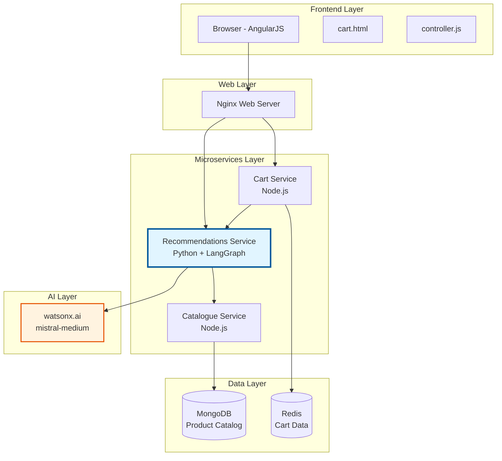
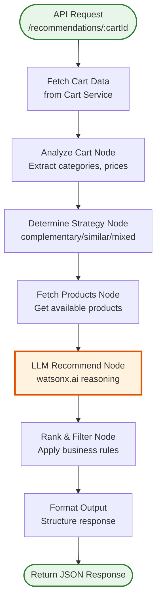
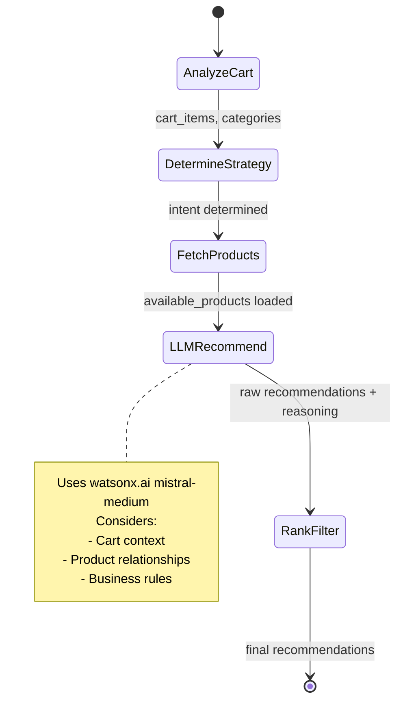
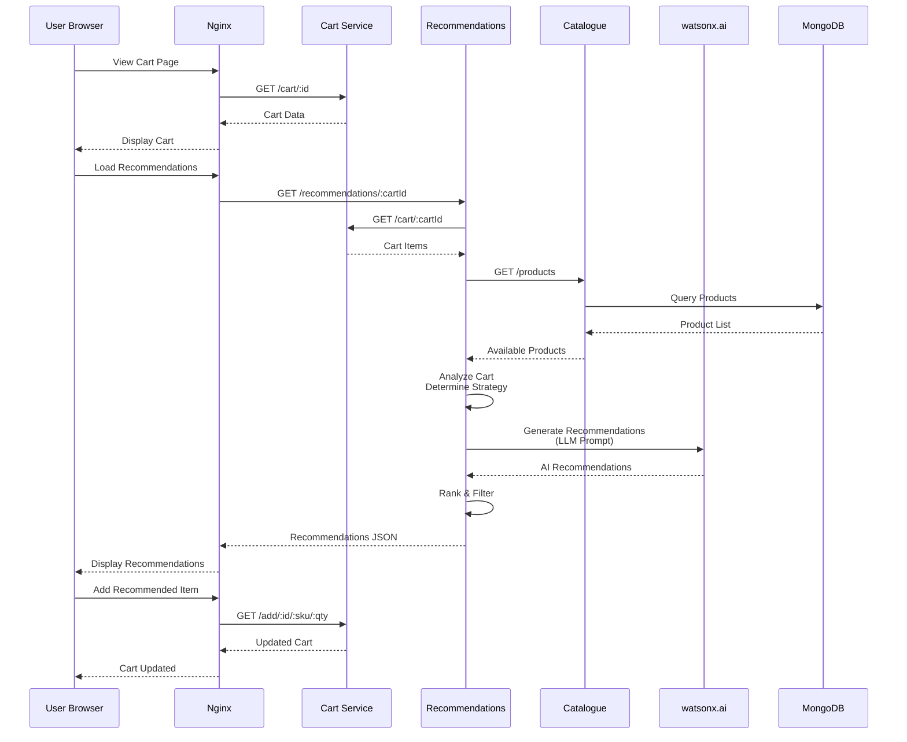
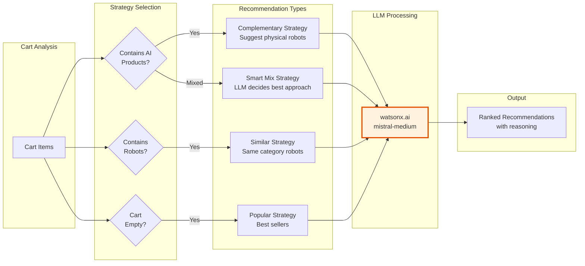
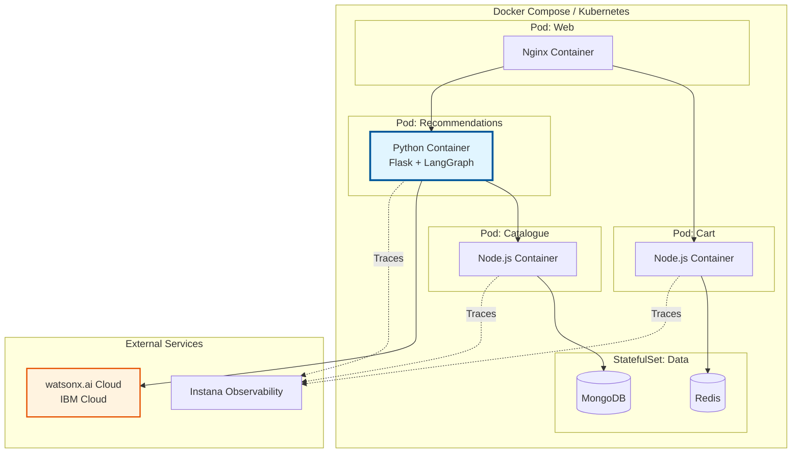
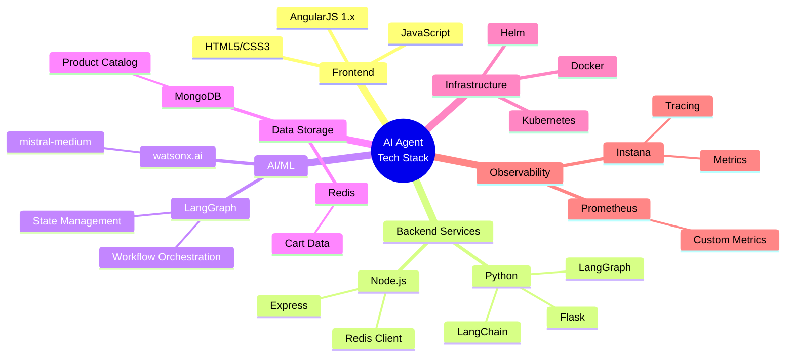
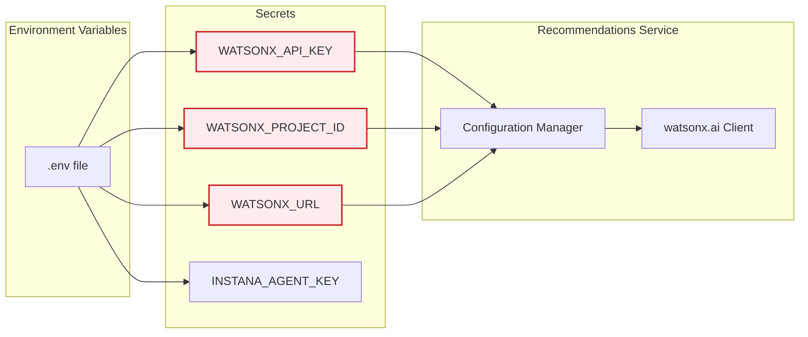
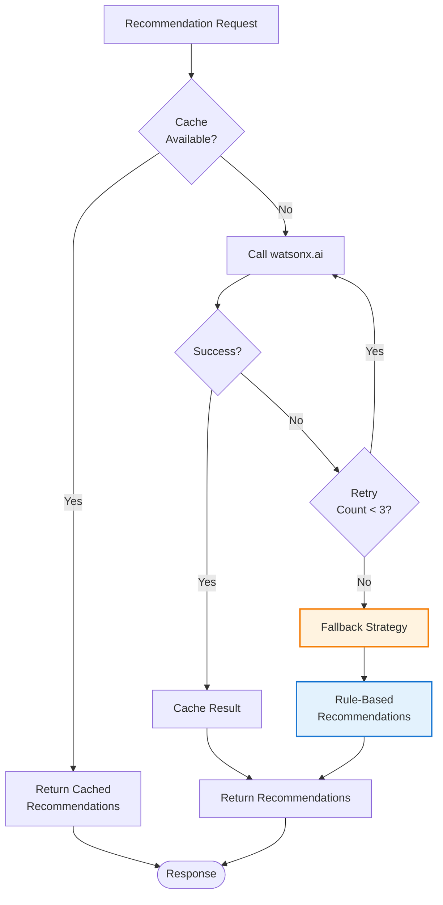

# AI Agent Architecture Diagram

## System Architecture



## LangGraph Agent Workflow



## Agent State Flow



## Data Flow Sequence



## Recommendation Strategies



## Deployment Architecture



## Component Interaction Matrix

| Component | Calls | Called By | Data Store | External API |
|-----------|-------|-----------|------------|--------------|
| **Browser** | Nginx | - | - | - |
| **Nginx** | Cart, Recommendations | Browser | - | - |
| **Cart Service** | Redis, Catalogue | Nginx, Recommendations | Redis | - |
| **Recommendations** | Catalogue, watsonx.ai | Nginx, Cart | - | watsonx.ai |
| **Catalogue** | MongoDB | Cart, Recommendations | MongoDB | - |

## Technology Stack Summary



## Security & Configuration



## Error Handling & Resilience



## Monitoring Dashboard Layout

```
┌─────────────────────────────────────────────────────────────┐
│  Recommendations Service - Instana Dashboard                │
├─────────────────────────────────────────────────────────────┤
│                                                               │
│  ┌──────────────┐  ┌──────────────┐  ┌──────────────┐      │
│  │ Request Rate │  │   Latency    │  │  Error Rate  │      │
│  │   125 req/s  │  │   245ms p95  │  │     0.2%     │      │
│  └──────────────┘  └──────────────┘  └──────────────┘      │
│                                                               │
│  ┌─────────────────────────────────────────────────────┐    │
│  │ watsonx.ai API Calls                                 │    │
│  │ ▂▃▅▇█▇▅▃▂▃▅▇█▇▅▃▂ (Last 1 hour)                    │    │
│  └─────────────────────────────────────────────────────┘    │
│                                                               │
│  ┌─────────────────────────────────────────────────────┐    │
│  │ Recommendation Acceptance Rate: 34%                  │    │
│  │ ████████████░░░░░░░░░░░░░░░░░░░░                    │    │
│  └─────────────────────────────────────────────────────┘    │
│                                                               │
│  ┌──────────────────┐  ┌──────────────────┐                │
│  │ Top Strategies   │  │ Cache Hit Rate   │                │
│  │ • Mixed: 45%     │  │      78%         │                │
│  │ • Complementary  │  │ ████████░░       │                │
│  │   32%            │  └──────────────────┘                │
│  │ • Similar: 23%   │                                       │
│  └──────────────────┘                                       │
└─────────────────────────────────────────────────────────────┘
```

## Key Design Decisions

1. **Python for AI Service**: Better ecosystem for AI/ML libraries
2. **LangGraph**: Provides structured workflow for complex agent logic
3. **watsonx.ai**: Enterprise-grade LLM with IBM support
4. **Microservice Pattern**: Maintains Robot Shop's architecture
5. **Graceful Degradation**: Service failure doesn't break cart functionality
6. **Caching Strategy**: Reduces watsonx.ai API calls and improves performance
7. **Instana Integration**: Maintains observability across all services

## Performance Targets

- **Response Time**: < 500ms p95
- **Availability**: 99.5%
- **Cache Hit Rate**: > 70%
- **Recommendation Acceptance**: > 25%
- **watsonx.ai API Success**: > 99%
