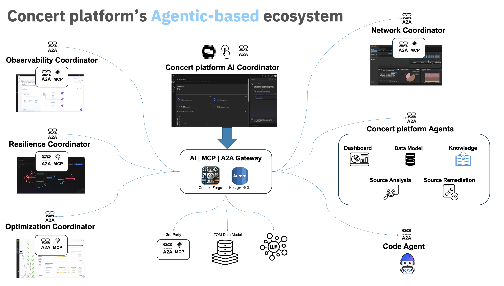
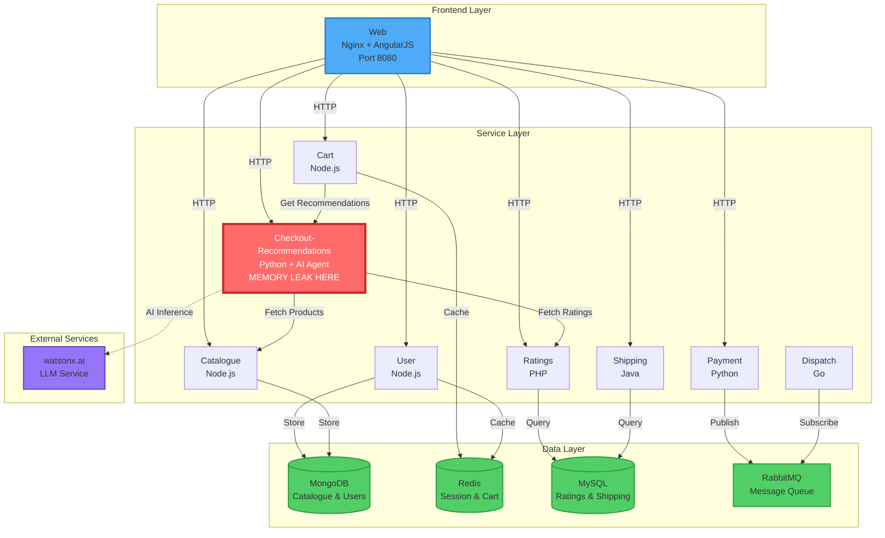

# Concert platform: Agentic AI for IT Operations

**🎯 Autonomous IT Operations Through AI Coordination**

*Demonstrating end-to-end incident resolution using Concert's agentic ecosystem*

---

## 🎬 Demo Overview

This demonstration showcases how IBM's Concert platform orchestrates multiple AI agents and coordinators to autonomously detect, diagnose, and resolve a production incident in the Robot Shop e-commerce application.

**Incident:** Memory leak in the new AI-powered checkout-recommendations service causing global checkout latency increases.

**Resolution Time:** From detection to remediation in minutes, not hours.

---

## 🏗️ Concert platform Architecture

*Concert platform's Agentic-based Ecosystem Architecture*

**Concert's Agentic-Based Ecosystem** orchestrates multiple specialized coordinators and agents:

- **🎯 AI Coordinator** - Central orchestration hub using LLM, MCP, and A2A protocols
- **👁️ Observability Coordinator** - Integrates with Instana for monitoring and APM  
- **🌐 Network Coordinator** - Connects to SevOne for network performance analysis
- **⚡ Optimization Coordinator** - Leverages Turbonomic for resource optimization
- **🛡️ Resilience Coordinator** - Manages resilience policies and improvements
- **🤖 platform Agents** - Specialized agents for dashboard, data model, knowledge, source analysis, and remediation
- **👨‍💻 Code Agent (Bob)** - LLM-as-a-judge for comprehensive code review and enhancement
- **🔗 Integration Layer** - AI | MCP | A2A Gateway with Context Forge and Aurora PostgreSQL

---

## 🏗️ Robot Shop Application Topology

---

## 📊 Act 1: Detection & Alert

### Scene: EUM Dashboard Shows Latency Spike

**Narrator:**
> "Our Robot Shop e-commerce platform is experiencing a critical performance degradation. End users are seeing checkout times increase from 500ms to over 2 seconds—a 450% increase that's impacting revenue and customer satisfaction."

---

## 🔍 Act 2: Fault Localization

**Narrator:**
> "Concert's Observability Coordinator, powered by Instana, has automatically identified the root cause: the newly deployed checkout-recommendations AI agent is experiencing memory exhaustion."

---

## 🤖 Act 3: AI Coordinator Orchestrates Resolution

**Narrator:**
> "The Concert AI Coordinator immediately creates a comprehensive action plan, orchestrating multiple specialized coordinators and agents to resolve this incident systematically."

Multi-Step Resolution Strategy:
- Step 1: Network assessment (SevOne)
- Step 2: Performance assessment (Turbonomic)
- Step 3: Root cause analysis (Instana and Source Analysis + GitHub MCP)
- Step 4: Remediation (Source remediation + ConcertCode Bob + GitHub MCP)
- Step 5: Improve resiliency (Concert)
- Step 6: ServiceNow update

---

### Step 1: Network Assessment

**Network Coordinator → SevOne**
✅ Network infrastructure is healthy - no anomalies detected

---

### Step 2: Performance Assessment

**Optimization Coordinator → Turbonomic**
🎯 Pending action found: Resize checkout-recommendations pod memory from 512MB to 1024MB

**Action Applied:** Memory doubled to 1024MB
- Memory Usage: 95% → 48%
---

### Step 3: Root Cause Analysis

**Instana Deep Dive**
🔴 **Diagnosis: MEMORY LEAK**
- Pattern: Linear unbounded growth
- Cause: Unbounded cache in tool_cache dictionary
- Impact: ~50MB per 1000 requests
- Trending towards OOM even after performance action

**Source Analysis Agent → GitHub MCP**
📍 **Memory Leak Found:** checkout-recommendations/server.py lines 20-45
- Issue: Unbounded dictionary caching MCP results
- No eviction policy (LRU, TTL, or size limit)
- 💡 Solution: Implement LRU cache with size limit

---

### Step 4: Remediation

**Source Remediation Agent**
✅ Created fix branch with LRU cache implementation
- Replaced dict with OrderedDict
- Added max_cache_size parameter (default: 1000)
- Implemented automatic eviction of oldest entries

**Code Agent (Bob) - LLM-as-a-Judge**
Comprehensive review and enhancements:
- ✅ Memory leak fix validated
- ✅ Added cache metrics endpoint
- ✅ Updated documentation
- ✅ Created comprehensive tests
- 🚀 Generated detailed pull request

---

### Step 5: Improve Resiliency

**Resilience Coordinator**
📊 Resiliency Score Plan: 6.5/10 → 9.2/10

**Actions:**
- ✅ Implemented Horizontal Pod Autoscaling (HPA)
- ✅ GitOps workflow created and deployed

---

### Step 6: ServiceNow Update

**Incident INC0012345: Resolved → Closed**

**Resolution Summary:**
- Detection: 2026-03-10 09:15:23 UTC
- Resolution: 2026-03-10 09:19:35 UTC
- **Total Time: 4 minutes 12 seconds**

**Actions Taken:**
- ✅ Network analyzed
- ✅ Memory increased 512MB → 1024MB 
- ✅ Source code analyzed 
- ✅ Memory leak remediation implemented
- ✅ PR created and merged
- ✅ HPA policy deployed for resilience
- ✅ Monitoring enhanced

---

## 🎯 Demo Summary: The Power of Agentic AI

### Key Achievements

**⏱️ Time to Resolution**
- Traditional: 4-8 hours
- Concert: 4 minutes

**🎯 Technologies Showcased**
- ✅ Instana (Observability)
- ✅ SevOne (Network Monitoring)
- ✅ Turbonomic (Optimization)
- ✅ Concert (Resiliency)
- ✅ Concert platform agents (Source analysis, source remediation, data model search)
- ✅ Bob (Code Architect)
- ✅ GitHub (Source Control + MCP)
- ✅ ServiceNow (ITSM)
- ✅ Kubernetes (Container Orchestration)
- ✅ MCP Protocol (Tool Integration)
- ✅ A2A Gateway (Agent Communication)
- ✅ LLM (AI Reasoning)
- ✅ GitOps (Infrastructure as Code)

---

## 🎬 Closing

**Narrator:**
> "This is the future of IT operations. Concert's agentic AI platform doesn't just monitor and alert—it understands, analyzes, fixes, and prevents. From detection to resolution, from code to infrastructure, from incident to improvement—all orchestrated autonomously by AI coordinators and specialized agents working together."

> "Welcome to autonomous IT operations. Welcome to Concert."

---

**IBM Think 2026**

*Transforming IT Operations with Agentic AI*

---

**Made with Bob** - Demonstrating the future of autonomous IT operations 🚀
