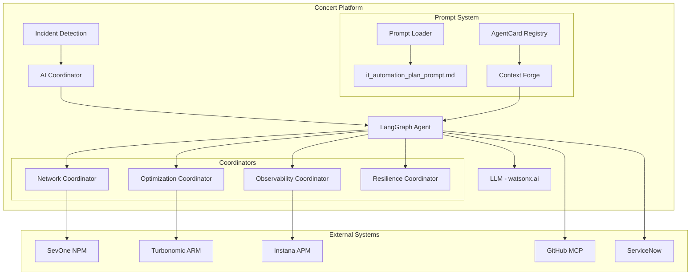
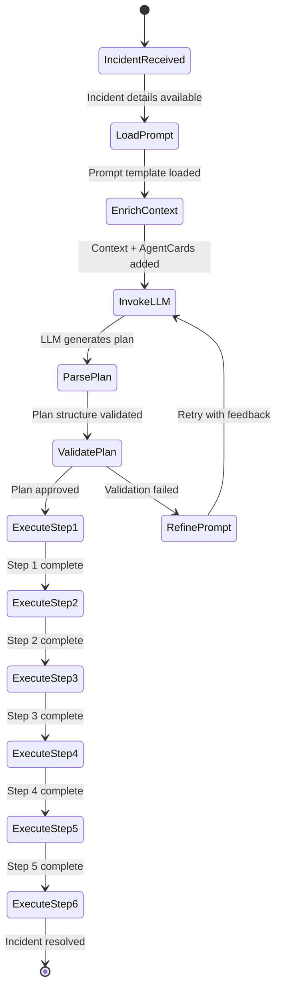
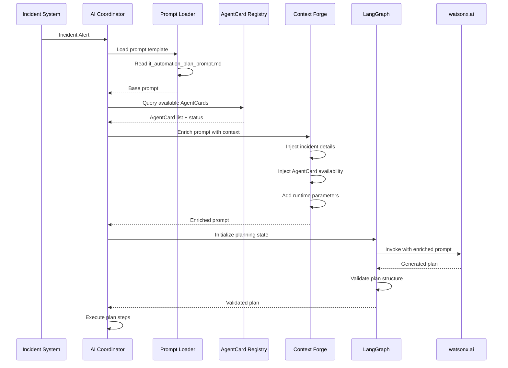

# Prompt Design Documentation - Concert Platform AI Coordinator

## Overview

This document describes the design, architecture, and implementation strategy for the IT Automation Plan Prompt used by the Concert Platform AI Coordinator to orchestrate autonomous incident resolution.

---

## Table of Contents

1. [Architecture Overview](#architecture-overview)
2. [Prompt Design Philosophy](#prompt-design-philosophy)
3. [LangGraph Integration Strategy](#langgraph-integration-strategy)
4. [Prompt Injection Workflow](#prompt-injection-workflow)
5. [AgentCard Discovery and Matching](#agentcard-discovery-and-matching)
6. [State Management](#state-management)
7. [Error Handling and Fallbacks](#error-handling-and-fallbacks)
8. [Testing and Validation](#testing-and-validation)
9. [Performance Considerations](#performance-considerations)
10. [Future Enhancements](#future-enhancements)

---

## Architecture Overview

### System Context



### Component Responsibilities

| Component | Responsibility |
|-----------|---------------|
| **AI Coordinator** | Receives incidents, orchestrates resolution workflow |
| **LangGraph Agent** | Manages state machine for plan execution |
| **Prompt Loader** | Loads and injects prompt template into LLM context |
| **AgentCard Registry** | Maintains catalog of available capabilities |
| **Context Forge** | Enriches prompt with runtime context and available agents |
| **LLM** | Generates execution plan based on prompt and context |

---

## Prompt Design Philosophy

### Core Principles

1. **Structured Guidance**: The prompt provides a clear, step-by-step framework that mirrors the Act 3 narrative
2. **Capability-Aware**: Explicitly lists available AgentCards and their skills
3. **Decision-Driven**: Includes decision points and branching logic
4. **Failure-Tolerant**: Handles missing capabilities gracefully
5. **Observable**: Each step produces measurable outcomes
6. **Autonomous**: Enables execution with minimal human intervention

### Prompt Structure Rationale

```
┌─────────────────────────────────────────┐
│ 1. Context Setting                      │  ← Establishes role and mission
├─────────────────────────────────────────┤
│ 2. Incident Details                     │  ← Provides specific problem context
├─────────────────────────────────────────┤
│ 3. Available Capabilities (AgentCards)  │  ← Lists tools at disposal
├─────────────────────────────────────────┤
│ 4. Required Plan Structure              │  ← Defines expected output format
├─────────────────────────────────────────┤
│ 5. Step-by-Step Templates               │  ← Provides detailed guidance per step
├─────────────────────────────────────────┤
│ 6. Guidelines and Best Practices        │  ← Ensures quality and consistency
├─────────────────────────────────────────┤
│ 7. Output Format Specification          │  ← Structures the response
└─────────────────────────────────────────┘
```

### Why This Structure Works

- **Top-Down Clarity**: Starts with high-level context, drills into specifics
- **Reference Architecture**: AgentCards section serves as a "tool catalog"
- **Template-Driven**: Each step has a template to follow
- **Constraint-Based**: Guidelines prevent common mistakes
- **Format-Enforced**: Output specification ensures parseable responses

---

## LangGraph Integration Strategy

### LangGraph State Machine

The Concert Platform uses LangGraph to manage the execution workflow. The prompt is injected at the planning phase.



### LangGraph Node Implementation

```python
from langgraph.graph import StateGraph, END
from typing import TypedDict, List, Dict, Any
import os

class PlanningState(TypedDict):
    """State for the planning phase"""
    incident_id: str
    incident_details: Dict[str, Any]
    available_agentcards: List[Dict[str, Any]]
    prompt_template: str
    enriched_prompt: str
    generated_plan: Dict[str, Any]
    validation_errors: List[str]
    execution_status: Dict[str, Any]

class ConcertPlanningAgent:
    """Concert Platform AI Coordinator Planning Agent"""
    
    def __init__(self, llm_client, agentcard_registry, prompt_path):
        self.llm = llm_client
        self.registry = agentcard_registry
        self.prompt_path = prompt_path
        
    def load_prompt_template(self, state: PlanningState) -> PlanningState:
        """Load the base prompt template"""
        with open(self.prompt_path, 'r') as f:
            state['prompt_template'] = f.read()
        return state
    
    def enrich_context(self, state: PlanningState) -> PlanningState:
        """Enrich prompt with runtime context"""
        # Get available AgentCards from registry
        state['available_agentcards'] = self.registry.get_available_cards()
        
        # Build context section
        context = self._build_context_section(
            state['incident_details'],
            state['available_agentcards']
        )
        
        # Inject context into prompt
        state['enriched_prompt'] = self._inject_context(
            state['prompt_template'],
            context
        )
        
        return state
    
    def invoke_llm(self, state: PlanningState) -> PlanningState:
        """Invoke LLM to generate plan"""
        response = self.llm.invoke(
            messages=[
                {"role": "system", "content": state['enriched_prompt']},
                {"role": "user", "content": "Generate the incident resolution plan."}
            ],
            temperature=0.3,  # Lower temperature for structured output
            max_tokens=4000
        )
        
        state['generated_plan'] = self._parse_plan(response.content)
        return state
    
    def validate_plan(self, state: PlanningState) -> PlanningState:
        """Validate the generated plan structure"""
        errors = []
        plan = state['generated_plan']
        
        # Check for all 6 required steps
        if len(plan.get('steps', [])) != 6:
            errors.append(f"Expected 6 steps, got {len(plan.get('steps', []))}")
        
        # Validate each step has required fields
        required_fields = ['name', 'coordinator', 'actions', 'success_criteria']
        for i, step in enumerate(plan.get('steps', []), 1):
            for field in required_fields:
                if field not in step:
                    errors.append(f"Step {i} missing required field: {field}")
        
        # Check AgentCard availability
        for step in plan.get('steps', []):
            coordinator = step.get('coordinator')
            if not self.registry.is_available(coordinator):
                errors.append(f"Coordinator not available: {coordinator}")
        
        state['validation_errors'] = errors
        return state
    
    def _build_context_section(self, incident, agentcards):
        """Build dynamic context section"""
        context = f"""
## Current Incident Context

**Incident ID:** {incident['id']}
**Timestamp:** {incident['timestamp']}
**Service:** {incident['service']}
**Severity:** {incident['severity']}
**Symptoms:**
{self._format_symptoms(incident['symptoms'])}

## Available AgentCards (Runtime)

"""
        for card in agentcards:
            context += f"""
### {card['name']}
**Status:** {'✅ Available' if card['available'] else '⚠️ Unavailable'}
**Integration:** {card['integration']}
**Skills:** {', '.join(card['skills'])}
"""
        
        return context
    
    def _inject_context(self, template, context):
        """Inject runtime context into template"""
        # Replace placeholder or prepend to prompt
        if "{{RUNTIME_CONTEXT}}" in template:
            return template.replace("{{RUNTIME_CONTEXT}}", context)
        else:
            return context + "\n\n" + template
    
    def _parse_plan(self, llm_response):
        """Parse LLM response into structured plan"""
        # Implementation depends on LLM output format
        # Could use JSON mode, structured output, or markdown parsing
        pass
    
    def _format_symptoms(self, symptoms):
        """Format symptoms list"""
        return "\n".join([f"- {s}" for s in symptoms])

# Build the LangGraph workflow
def create_planning_workflow(agent: ConcertPlanningAgent):
    """Create the LangGraph workflow for planning"""
    workflow = StateGraph(PlanningState)
    
    # Add nodes
    workflow.add_node("load_prompt", agent.load_prompt_template)
    workflow.add_node("enrich_context", agent.enrich_context)
    workflow.add_node("invoke_llm", agent.invoke_llm)
    workflow.add_node("validate_plan", agent.validate_plan)
    
    # Define edges
    workflow.set_entry_point("load_prompt")
    workflow.add_edge("load_prompt", "enrich_context")
    workflow.add_edge("enrich_context", "invoke_llm")
    workflow.add_edge("invoke_llm", "validate_plan")
    
    # Conditional edge based on validation
    workflow.add_conditional_edges(
        "validate_plan",
        lambda state: "retry" if state['validation_errors'] else "execute",
        {
            "retry": "invoke_llm",  # Retry with feedback
            "execute": END  # Proceed to execution
        }
    )
    
    return workflow.compile()
```

---

## Prompt Injection Workflow

### Injection Points

The prompt is injected at multiple points in the workflow:



### Context Enrichment Strategy

The base prompt template is enriched with runtime context:

```python
def enrich_prompt_with_context(
    base_prompt: str,
    incident: Dict[str, Any],
    agentcards: List[Dict[str, Any]],
    system_state: Dict[str, Any]
) -> str:
    """
    Enrich the base prompt with runtime context
    
    Args:
        base_prompt: The loaded template from it_automation_plan_prompt.md
        incident: Current incident details
        agentcards: Available AgentCards with status
        system_state: Current system state (load, health, etc.)
    
    Returns:
        Enriched prompt ready for LLM
    """
    
    # 1. Build incident context
    incident_context = f"""
## CURRENT INCIDENT (Runtime Injection)

**ID:** {incident['id']}
**Detected:** {incident['timestamp']}
**Service:** {incident['service']}
**Environment:** {incident['environment']}
**Severity:** {incident['severity']}

**Symptoms:**
{format_list(incident['symptoms'])}

**Current Metrics:**
- Latency P95: {incident['metrics']['latency_p95']}ms
- Error Rate: {incident['metrics']['error_rate']}%
- Memory Usage: {incident['metrics']['memory_usage']}%
- CPU Usage: {incident['metrics']['cpu_usage']}%

**Business Impact:**
- Affected Users: {incident['impact']['affected_users']}
- Revenue Impact: ${incident['impact']['revenue_per_minute']}/min
- SLA Status: {incident['impact']['sla_status']}
"""
    
    # 2. Build AgentCard availability section
    agentcard_context = """
## AVAILABLE AGENTCARDS (Runtime Status)

"""
    for card in agentcards:
        status_icon = "✅" if card['available'] else "❌"
        agentcard_context += f"""
### {status_icon} {card['name']}
**Status:** {'Available' if card['available'] else 'Unavailable'}
**Response Time:** {card.get('avg_response_time', 'N/A')}ms
**Success Rate:** {card.get('success_rate', 'N/A')}%
**Last Health Check:** {card.get('last_health_check', 'N/A')}
**Integration:** {card['integration']}
**Capabilities:**
{format_list(card['skills'])}

"""
        if not card['available']:
            agentcard_context += f"**Fallback:** {card.get('fallback_procedure', 'Manual intervention required')}\n\n"
    
    # 3. Build system state context
    system_context = f"""
## SYSTEM STATE (Runtime)

**Platform Load:** {system_state['load']}%
**Active Incidents:** {system_state['active_incidents']}
**Coordinator Health:** {system_state['coordinator_health']}
**Estimated Resolution Time:** {system_state['estimated_resolution_time']} minutes
"""
    
    # 4. Inject all context sections
    enriched = f"""
{incident_context}

{agentcard_context}

{system_context}

---

{base_prompt}
"""
    
    return enriched

def format_list(items: List[str]) -> str:
    """Format list items with bullets"""
    return "\n".join([f"- {item}" for item in items])
```

---

## AgentCard Discovery and Matching

### AgentCard Registry

The AgentCard Registry maintains a catalog of available capabilities:

```python
class AgentCardRegistry:
    """Registry for managing AgentCards"""
    
    def __init__(self, config_path: str):
        self.cards = self._load_cards(config_path)
        self.health_checker = HealthChecker()
    
    def get_available_cards(self) -> List[Dict[str, Any]]:
        """Get all available AgentCards with current status"""
        available = []
        for card in self.cards:
            status = self.health_checker.check(card)
            card_info = {
                'name': card['name'],
                'integration': card['integration'],
                'skills': card['skills'],
                'available': status['healthy'],
                'avg_response_time': status['avg_response_time'],
                'success_rate': status['success_rate'],
                'last_health_check': status['timestamp']
            }
            available.append(card_info)
        return available
    
    def is_available(self, coordinator_name: str) -> bool:
        """Check if a specific coordinator is available"""
        card = self._find_card(coordinator_name)
        if not card:
            return False
        status = self.health_checker.check(card)
        return status['healthy']
    
    def get_fallback(self, coordinator_name: str) -> Optional[str]:
        """Get fallback procedure if coordinator unavailable"""
        card = self._find_card(coordinator_name)
        return card.get('fallback_procedure') if card else None
    
    def _load_cards(self, config_path: str) -> List[Dict]:
        """Load AgentCard definitions from config"""
        # Load from YAML/JSON configuration
        pass
    
    def _find_card(self, name: str) -> Optional[Dict]:
        """Find card by name"""
        return next((c for c in self.cards if c['name'] == name), None)
```

### AgentCard Configuration Example

```yaml
# agentcards.yaml
agentcards:
  - name: "Network Coordinator"
    integration: "SevOne NPM"
    endpoint: "https://sevone.example.com/api"
    health_check: "/health"
    timeout: 30
    skills:
      - "Network infrastructure health assessment"
      - "Anomaly detection in network metrics"
      - "Bandwidth and latency analysis"
      - "Network topology validation"
    fallback_procedure: "Manual network health check via SevOne dashboard"
    
  - name: "Optimization Coordinator"
    integration: "Turbonomic ARM"
    endpoint: "https://turbonomic.example.com/api"
    health_check: "/health"
    timeout: 45
    skills:
      - "Resource utilization analysis"
      - "Performance action recommendations"
      - "Memory and CPU optimization"
      - "Pod/container resizing recommendations"
    fallback_procedure: "Manual resource analysis via Turbonomic console"
    
  - name: "Observability Coordinator"
    integration: "Instana APM"
    endpoint: "https://instana.example.com/api"
    health_check: "/health"
    timeout: 30
    skills:
      - "Deep application performance analysis"
      - "Memory leak detection and profiling"
      - "Distributed tracing analysis"
      - "Service dependency mapping"
    fallback_procedure: "Manual APM analysis via Instana dashboard"
```

---

## State Management

### LangGraph State Schema

```python
from typing import TypedDict, List, Dict, Any, Optional
from datetime import datetime

class IncidentState(TypedDict):
    """Complete state for incident resolution"""
    # Incident Information
    incident_id: str
    incident_type: str
    severity: str
    detected_at: datetime
    service_name: str
    environment: str
    
    # Planning Phase
    prompt_template: str
    enriched_prompt: str
    available_agentcards: List[Dict[str, Any]]
    generated_plan: Dict[str, Any]
    validation_errors: List[str]
    
    # Execution Phase
    current_step: int
    step_results: List[Dict[str, Any]]
    execution_log: List[str]
    
    # Step 1: Network Assessment
    network_health: Optional[Dict[str, Any]]
    network_anomalies: List[str]
    
    # Step 2: Performance Assessment
    performance_actions: List[Dict[str, Any]]
    resource_changes: List[Dict[str, Any]]
    
    # Step 3: Root Cause Analysis
    root_cause: Optional[Dict[str, Any]]
    affected_files: List[str]
    recommended_fix: Optional[str]
    
    # Step 4: Remediation
    fix_branch: Optional[str]
    pull_request_url: Optional[str]
    code_review_results: Optional[Dict[str, Any]]
    
    # Step 5: Resilience
    resilience_score_before: Optional[float]
    resilience_score_after: Optional[float]
    resilience_actions: List[Dict[str, Any]]
    
    # Step 6: ITSM
    ticket_updated: bool
    resolution_time: Optional[int]
    
    # Overall Status
    status: str  # planning, executing, completed, failed
    error: Optional[str]
    completed_at: Optional[datetime]
```

### State Transitions

```python
def execute_step(state: IncidentState, step_number: int) -> IncidentState:
    """Execute a specific step in the plan"""
    
    step = state['generated_plan']['steps'][step_number - 1]
    coordinator = step['coordinator']
    
    # Log step start
    state['execution_log'].append(
        f"[{datetime.now()}] Starting Step {step_number}: {step['name']}"
    )
    
    try:
        # Execute step based on coordinator
        if coordinator == "Network Coordinator":
            result = execute_network_assessment(state, step)
            state['network_health'] = result
        elif coordinator == "Optimization Coordinator":
            result = execute_performance_assessment(state, step)
            state['performance_actions'] = result
        elif coordinator == "Observability Coordinator":
            result = execute_root_cause_analysis(state, step)
            state['root_cause'] = result
        # ... other coordinators
        
        # Record step result
        state['step_results'].append({
            'step': step_number,
            'name': step['name'],
            'status': 'completed',
            'result': result,
            'completed_at': datetime.now()
        })
        
        # Update current step
        state['current_step'] = step_number + 1
        
    except Exception as e:
        state['step_results'].append({
            'step': step_number,
            'name': step['name'],
            'status': 'failed',
            'error': str(e),
            'failed_at': datetime.now()
        })
        state['status'] = 'failed'
        state['error'] = f"Step {step_number} failed: {str(e)}"
    
    return state
```

---

## Error Handling and Fallbacks

### Handling Missing AgentCards

```python
def handle_missing_agentcard(
    state: IncidentState,
    coordinator_name: str,
    step: Dict[str, Any]
) -> IncidentState:
    """Handle case where required AgentCard is unavailable"""
    
    # Log the issue
    state['execution_log'].append(
        f"⚠️ {coordinator_name} unavailable for {step['name']}"
    )
    
    # Get fallback procedure
    fallback = registry.get_fallback(coordinator_name)
    
    if fallback:
        # Execute fallback
        state['execution_log'].append(f"Executing fallback: {fallback}")
        result = execute_fallback_procedure(fallback, step)
        return result
    else:
        # Request human intervention
        state['execution_log'].append(
            f"❌ No fallback available. Human intervention required."
        )
        state['status'] = 'requires_intervention'
        state['intervention_required'] = {
            'step': step['name'],
            'coordinator': coordinator_name,
            'reason': 'AgentCard unavailable and no fallback defined'
        }
        return state
```

### Retry Logic

```python
def invoke_llm_with_retry(
    llm_client,
    prompt: str,
    max_retries: int = 3,
    backoff_factor: float = 2.0
) -> str:
    """Invoke LLM with exponential backoff retry"""
    
    for attempt in range(max_retries):
        try:
            response = llm_client.invoke(prompt)
            return response
        except Exception as e:
            if attempt == max_retries - 1:
                raise
            
            wait_time = backoff_factor ** attempt
            logger.warning(
                f"LLM invocation failed (attempt {attempt + 1}/{max_retries}). "
                f"Retrying in {wait_time}s. Error: {str(e)}"
            )
            time.sleep(wait_time)
```

---

## Testing and Validation

### Unit Tests

```python
import pytest
from concert_platform.planning import ConcertPlanningAgent

def test_prompt_loading():
    """Test prompt template loading"""
    agent = ConcertPlanningAgent(
        llm_client=mock_llm,
        agentcard_registry=mock_registry,
        prompt_path="it_automation_plan_prompt.md"
    )
    
    state = {'incident_id': 'INC001'}
    result = agent.load_prompt_template(state)
    
    assert 'prompt_template' in result
    assert len(result['prompt_template']) > 0
    assert 'Act 3' in result['prompt_template']

def test_context_enrichment():
    """Test context enrichment with AgentCards"""
    agent = ConcertPlanningAgent(...)
    
    state = {
        'prompt_template': base_prompt,
        'incident_details': mock_incident,
        'available_agentcards': []
    }
    
    result = agent.enrich_context(state)
    
    assert 'enriched_prompt' in result
    assert mock_incident['id'] in result['enriched_prompt']

def test_plan_validation():
    """Test plan validation logic"""
    agent = ConcertPlanningAgent(...)
    
    # Valid plan
    valid_plan = {
        'steps': [
            {'name': 'Step 1', 'coordinator': 'Network Coordinator', 
             'actions': [], 'success_criteria': []},
            # ... 5 more steps
        ]
    }
    
    state = {'generated_plan': valid_plan}
    result = agent.validate_plan(state)
    
    assert len(result['validation_errors']) == 0
    
    # Invalid plan (missing steps)
    invalid_plan = {'steps': []}
    state = {'generated_plan': invalid_plan}
    result = agent.validate_plan(state)
    
    assert len(result['validation_errors']) > 0
```

### Integration Tests

```python
def test_end_to_end_planning():
    """Test complete planning workflow"""
    # Setup
    agent = ConcertPlanningAgent(
        llm_client=real_llm_client,
        agentcard_registry=real_registry,
        prompt_path="it_automation_plan_prompt.md"
    )
    
    workflow = create_planning_workflow(agent)
    
    # Execute
    initial_state = {
        'incident_id': 'INC001',
        'incident_details': test_incident,
        'available_agentcards': [],
        'prompt_template': '',
        'enriched_prompt': '',
        'generated_plan': {},
        'validation_errors': [],
        'execution_status': {}
    }
    
    final_state = workflow.invoke(initial_state)
    
    # Verify
    assert final_state['status'] == 'completed'
    assert len(final_state['generated_plan']['steps']) == 6
    assert len(final_state['validation_errors']) == 0
```

---

## Performance Considerations

### Prompt Size Optimization

The prompt template is approximately 8,000 tokens. With context enrichment, it can grow to 12,000-15,000 tokens.

**Optimization Strategies:**

1. **Lazy Loading**: Only load AgentCard details for available coordinators
2. **Compression**: Remove verbose examples if token limit approached
3. **Caching**: Cache enriched prompts for similar incidents
4. **Streaming**: Use streaming responses for faster time-to-first-token

```python
def optimize_prompt_size(
    base_prompt: str,
    context: Dict[str, Any],
    max_tokens: int = 15000
) -> str:
    """Optimize prompt to fit within token budget"""
    
    # Estimate tokens (rough: 1 token ≈ 4 characters)
    estimated_tokens = len(base_prompt) / 4
    
    if estimated_tokens > max_tokens:
        # Remove optional sections
        base_prompt = remove_examples(base_prompt)
        base_prompt = compress_guidelines(base_prompt)
    
    return base_prompt
```

### LLM Response Time

Target: < 10 seconds for plan generation

**Optimization:**
- Use lower temperature (0.3) for faster, more deterministic responses
- Set appropriate max_tokens limit
- Use streaming for progressive output
- Consider caching for similar incidents

---

## Future Enhancements

### 1. Dynamic Prompt Adaptation

Learn from successful resolutions to adapt the prompt:

```python
class AdaptivePromptManager:
    """Manages prompt evolution based on outcomes"""
    
    def __init__(self):
        self.success_patterns = []
        self.failure_patterns = []
    
    def learn_from_resolution(self, incident, plan, outcome):
        """Learn from resolution outcomes"""
        if outcome['success']:
            self.success_patterns.append({
                'incident_type': incident['type'],
                'plan_structure': plan,
                'resolution_time': outcome['time']
            })
        else:
            self.failure_patterns.append({
                'incident_type': incident['type'],
                'plan_structure': plan,
                'failure_reason': outcome['reason']
            })
    
    def adapt_prompt(self, base_prompt, incident_type):
        """Adapt prompt based on learned patterns"""
        # Add successful patterns as examples
        # Warn about common failure modes
        pass
```

### 2. Multi-LLM Consensus

Use multiple LLMs to generate plans and select best:

```python
def generate_plan_with_consensus(
    incident: Dict,
    llm_clients: List[LLMClient]
) -> Dict:
    """Generate plans from multiple LLMs and select best"""
    
    plans = []
    for llm in llm_clients:
        plan = llm.generate_plan(incident)
        score = evaluate_plan(plan)
        plans.append((plan, score))
    
    # Select highest scoring plan
    best_plan = max(plans, key=lambda x: x[1])[0]
    return best_plan
```

### 3. Real-Time Prompt Refinement

Refine prompt during execution based on step outcomes:

```python
def refine_prompt_during_execution(
    state: IncidentState,
    step_result: Dict
) -> str:
    """Refine prompt for next steps based on current results"""
    
    if step_result['status'] == 'failed':
        # Add failure context to prompt
        refinement = f"""
## IMPORTANT: Previous Step Failed

Step {step_result['step']} ({step_result['name']}) failed with error:
{step_result['error']}

Please adjust the plan to account for this failure.
"""
        return state['enriched_prompt'] + refinement
    
    return state['enriched_prompt']
```

### 4. Prompt Versioning

Track prompt versions and their effectiveness:

```yaml
# prompt_versions.yaml
versions:
  - version: "1.0.0"
    path: "prompts/it_automation_plan_v1.md"
    created: "2026-03-01"
    success_rate: 0.85
    avg_resolution_time: 4.5
    
  - version: "1.1.0"
    path: "prompts/it_automation_plan_v1_1.md"
    created: "2026-03-15"
    success_rate: 0.92
    avg_resolution_time: 3.8
    changes:
      - "Added explicit fallback procedures"
      - "Enhanced AgentCard matching logic"
      - "Improved decision point clarity"
```

---

## Conclusion

This prompt design enables the Concert Platform AI Coordinator to autonomously orchestrate complex incident resolution workflows. The structured approach, combined with runtime context enrichment and robust error handling, provides a foundation for reliable, observable, and adaptive IT automation.

### Key Takeaways

1. **Structured Guidance**: The prompt provides clear, step-by-step framework
2. **Runtime Adaptation**: Context enrichment makes prompt incident-specific
3. **Capability-Aware**: AgentCard registry ensures realistic planning
4. **Failure-Tolerant**: Graceful degradation when capabilities unavailable
5. **Observable**: Each step produces measurable outcomes
6. **Evolvable**: Design supports continuous improvement

### Success Metrics

- **Plan Generation Time**: < 10 seconds
- **Plan Validation Success**: > 95%
- **Incident Resolution Time**: < 5 minutes (vs 4-8 hours traditional)
- **Autonomous Resolution Rate**: > 90%
- **AgentCard Utilization**: > 80%

---